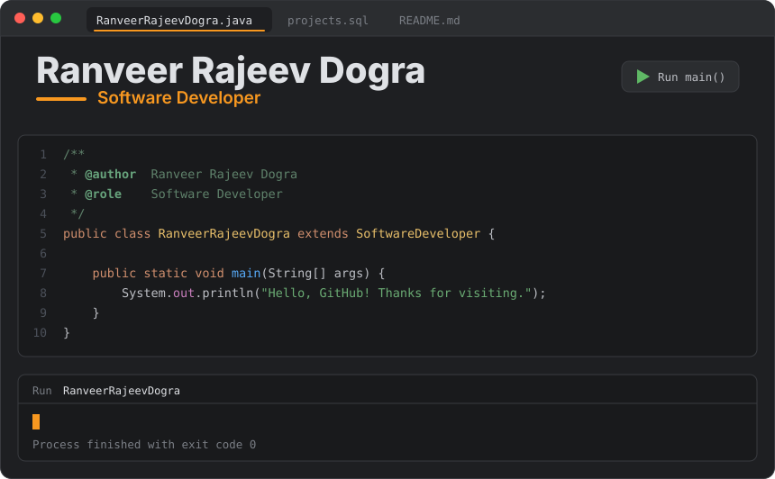
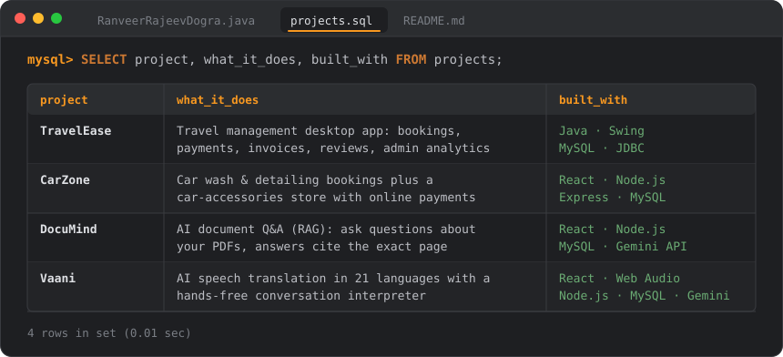
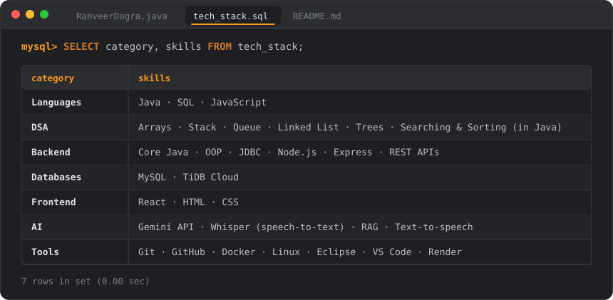
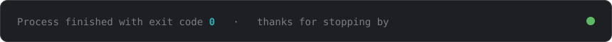

  

   SELECT project, what_it_does, built_with FROM projects; TravelEase (Java, Swing, MySQL, JDBC), CarZone (React, Node.js, Express, MySQL), DocuMind (AI document Q&A with RAG; React, Node.js, MySQL, Gemini API), Vaani (AI speech translation in 21 languages; React, Web Audio, Node.js, MySQL, Gemini)" />

   SELECT category, skills FROM tech_stack; Languages: Java, SQL, JavaScript. DSA: Arrays, Stack, Queue, Linked List, Trees, Searching and Sorting in Java. Backend: Core Java, OOP, JDBC, Node.js, Express, REST APIs. Databases: MySQL, TiDB Cloud. Frontend: React, HTML, CSS. AI: Gemini API, Whisper, RAG, Text-to-speech. Tools: Git, GitHub, Docker, Linux, Eclipse, VS Code, Render." />

   SELECT * FROM contributions;" />

  <picture>
    <source media="(prefers-color-scheme: dark)" srcset="https://raw.githubusercontent.com/dogra11/dogra11/output/github-snake-dark.svg" />
    <source media="(prefers-color-scheme: light)" srcset="https://raw.githubusercontent.com/dogra11/dogra11/output/github-snake.svg" />
    
  </picture>

  

<!-- TTT:START -->

 
 

Visitors won the last game! 🎉 <a href="https://github.com/dogra11/dogra11/issues/new?title=ttt%7Cnew&body=Just%20click%20**Create**%20below%20-%20the%20bot%20will%20play%20its%20move%20in%20a%20few%20seconds%20and%20update%20the%20board.%20%F0%9F%8E%AE"><b>Start a new game</b></a> or just click a tile. 🏆 Visitors 1 · 🤖 Bot 0 · 🤝 Draws 1 &nbsp;|&nbsp; recent: 🏆 @Kanishk-create won · 🤝 @dogra11 drew

<!-- TTT:END -->

Click an empty tile, then press <b>Create</b> on the page that opens. The bot answers in a few seconds - refresh this page to see its move.

  

  
  &nbsp;
  

  

